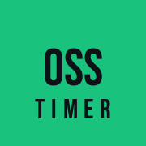

# OSS TIMER

<p align="center">
  <br>
  <strong>Seu treino. Seu ritmo.</strong><br>
  Timer de treino para jiu-jitsu, rounds e intervalos.
</p>

<p align="center">
  
  
  
</p>

O **OSS Timer** é um aplicativo web progressivo (PWA) feito para acompanhar o ritmo do treino sem tirar o foco da luta. A interface de alto contraste destaca a fase atual, o tempo restante e o que vem a seguir. Instale no celular ou use no navegador — inclusive offline, depois de carregar o app.

## Modos de treino

| Tabata | Rondas | Cronômetro |
|:---|:---|:---|
| Crie sessões intervaladas com fases, rounds, ciclos e descanso. | Configure um timer dedicado para rounds de luta. | Acompanhe o tempo livre e registre voltas. |

## Recursos

- **Tabata e treinos personalizados** — todos os ajustes permanecem visíveis, com atalhos para tempo de luta e rounds e prévia da duração total.
- **Timer de rondas** — acompanhe ronda e ciclo atuais, fases seguintes e tempo restante da sessão com uma configuração independente do Tabata.
- **Cronômetro livre** — acompanhe o tempo decorrido e consulte as três voltas mais recentes, com tempo parcial e acumulado.
- **Sinais durante o treino** — bipes, avisos por voz em português e contagem regressiva.
- **Música durante avisos no iPhone** — clipes de voz em português incluídos no app são reproduzidos pelo Web Audio para permitir a mixagem com outras mídias; em outros dispositivos, o app usa a síntese de fala nativa.
- **iPhone com notch e barra segura** — cabeçalho, área de ação e barra inferior respeitam os limites do aparelho sem blur excessivo nem sobreposição de texto ou botões.
- **Sessão sem interrupções** — opção para manter a tela ligada durante o treino.
- **Pronto para instalar** — PWA com cache offline, ícone OSS Timer otimizado para a tela inicial do iPhone e layout para celular.

## Começar

### Usar no navegador

Abra `index.html` para experimentar o aplicativo. Para testar a instalação e os recursos de PWA, publique os arquivos em uma origem HTTPS ou rode um servidor local:

```bash
python -m http.server 8000
```

Depois, acesse [http://localhost:8000](http://localhost:8000). O servidor local serve apenas para desenvolvimento; para instalar o PWA no iPhone, use um endereço HTTPS e abra-o no Safari.

### Instalar

Publique o app em um endereço HTTPS. No iPhone, abra esse endereço no **Safari**, toque em **Compartilhar** e escolha **Adicionar à Tela de Início**. O ícone da tela inicial usa uma imagem dedicada de 180 × 180 pixels, com fundo opaco e contraste ajustado para o recorte arredondado do iOS. Depois de carregar o app, o cache permite continuar usando-o offline.

Em outros navegadores compatíveis, use **Instalar aplicativo** ou **Adicionar à tela inicial**. O manifesto inclui ícones de 192 e 512 pixels, com o maior preparado também para máscaras de ícones. No iPhone, a barra de status usa fundo opaco para evitar transparência e blur sob o notch; o layout também reserva as áreas seguras (notch/Dynamic Island e indicador de início), acompanha a altura dinâmica do navegador e reorganiza os controles em paisagem.

O arquivo vetorial de origem do ícone é [`icons/oss-timer-app-icon.svg`](icons/oss-timer-app-icon.svg); as imagens PNG usadas pelo app são exportadas desse desenho.

## Testes

Abra [`tests/test-runner.html`](tests/test-runner.html) no navegador para executar a suíte de testes JavaScript. O painel mostra os resultados, permite filtrar aprovados ou reprovados e pesquisar pelo nome ou mensagem.

Para validar os recursos do PWA e os arquivos locais:

```bash
python tests/verificar-pwa.py
```

## Privacidade

Treinos e preferências são armazenados localmente no aparelho. O app não exige conta e não envia esses dados para um servidor. A política completa está disponível em **Mais → Política de Privacidade**.

## Estrutura do projeto

```text
index.html           Aplicativo e estrutura das telas
style.css            Identidade visual e layout responsivo
app.js               Interface, interações e integração dos recursos
app-ui.js            Apresentação e rótulos do timer
timer-engine.js      Lógica de fases, rounds, ciclos e cronômetro
storage.js           Persistência local de treinos e preferências
audio.js / voice.js  Sinais sonoros e instruções por voz
audio-voz/           Clipes offline usados pela voz no iPhone
sw.js                Cache e funcionamento offline
tests/               Página de testes e verificação do PWA
```

## Desenvolvimento

O projeto usa HTML, CSS e JavaScript puros, sem etapa de build ou dependências de pacote. As configurações permanecem no dispositivo.
